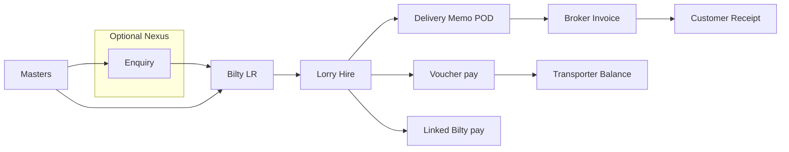

# Broker Operational Flow Standard (Nexus)

**Date:** 24 November 2026  
**Authority:** **PO-LGC-017 (Accepted)** — reproduce legacy `truckbill_broker` operator journeys where compatible with Nexus rules.  
**Legacy reference:** `6a90e955bd7a05497f60a6d0bd72891c880e6d14`  
**Nexus implementation baseline:** `701f4df` → Batch 2 OF continuation tip  
**Verification:** Source-verified from legacy routes/controllers and Nexus `routes/web.php` + pages; Playwright browser-verified for Save & Create Hire, edit confirmation, Record voucher, complete spine.

---

## Scope

This document defines the **happy-path operational sequence** for market-hired (broker) work in the Branch panel. It is not a functional parity scorecard. Deferred areas (full reports, GL accounting, custom invoices) stay governed by existing PO-LGC and Phase 11 gates.

---

## Standard flow overview

---

## 1. Masters (prerequisite)

| Step                          | Legacy                                                        | Nexus                                           | Intentional differences                 |
| ----------------------------- | ------------------------------------------------------------- | ----------------------------------------------- | --------------------------------------- |
| Party / vehicle setup         | Separate transporter, owner, consignee, truck, driver screens | Party Master + Vehicle Master with role filters | Unified Party; owner role policy merged |
| Stations / goods / truck type | `master/*` under company Setup                                | Branch catalogues + owner-shared stations       | Tenant/owner scope per architecture     |
| Bank accounts                 | `truck_owner_bank_accounts`, `transporter_bank_accounts`      | Bank/Cash accounts                              | Single master with isolation tests      |

**Operator rule:** Select parties via **search** (not static dropdown) on all high-volume forms (Batch 2 standard).

---

## 2. Enquiry (Nexus-only entry)

| Step           | Legacy                        | Nexus                                                     |
| -------------- | ----------------------------- | --------------------------------------------------------- |
| Capture demand | Often informal / direct bilty | `POST` enquiry create with customer search + confirmation |

Legacy has no sidebar Enquiry; Nexus treats enquiry as optional front door to bilty. **Intentional Difference.**

---

## 3. Bilty (Lorry Receipt)

| Step                  | Legacy controller flow         | Nexus flow                                      | Confirmation                                                            |
| --------------------- | ------------------------------ | ----------------------------------------------- | ----------------------------------------------------------------------- |
| Create                | `LorryReceiptController@store` | `LorryReceiptService::create` via `lr-form.tsx` | Expanded review: parties, stations, goods rows, EWB, charges, MT totals |
| Edit                  | Open update while allowed      | Update with financial freeze boundaries         | Previous/new `ChangeReview` (browser-verified)                          |
| Bulk customer payment | `lorry_receipts/bulk-payment`  | Not mapped 1:1 in Batch 2 UX doc                | Track in BRK-LR* register                                               |

**Weight standard:** Enter operational weights in **MT** with KG Wt./Unit assist — not legacy single-field assumptions (`OPERATIONAL_WEIGHT_UNIT_STANDARD.md`).

---

## 4. Lorry Hire (market hire)

| Step             | Legacy                            | Nexus                                                 |
| ---------------- | --------------------------------- | ----------------------------------------------------- |
| Create from LR   | `FreightBookingController@store`  | `LorryHireController@storeFromLorryReceipt`           |
| Payee selection  | Implicit transporter/owner        | Explicit payee + **role_label** chip                  |
| Margin signal    | Operator habit / legacy UI hints  | Amber when transporter freight **>** customer freight |
| Lifecycle change | `FreightBookingController@update` | Adjustments + cancel (**PO-LGC-007**)                 |
| Settlement PDF   | `settlementStatement`             | Deferred **PO-LGC-006**                               |

---

## 5. Voucher (transporter payment)

| Step           | Legacy                                  | Nexus                                                |
| -------------- | --------------------------------------- | ---------------------------------------------------- |
| Create         | `VoucherPaymentController@create/store` | `TransporterVoucherController@create/store`          |
| Hire context   | Embedded in hire/payment UX             | **Hire context panel** + `?lorry_hire_id=` preselect |
| From hire show | Navigate to payment                     | **Record voucher** CTA with hire id                  |
| Edit/void      | `edit`, `update`, `destroy`             | Not ported — **PO-LGC-003**                          |
| Bulk / daily   | `bulkPayment`, `dailyPayments`          | `bulkStore`, `daily-payments` index                  |

**Financial rule:** Posted vouchers immutable; corrections via reversal workflow (Nexus), not silent destroy.

---

## 6. Delivery, Memo, POD

| Step              | Legacy                                                            | Nexus                                                     |
| ----------------- | ----------------------------------------------------------------- | --------------------------------------------------------- |
| Memo assignment   | `freight_bookings/bulk-memo-id`, memo fields on hire/LR ecosystem | `BrokerDeliveryController@assignMemo` on deliveries index |
| Delivery complete | LR/hire status transitions in legacy views                        | `deliveries/{lr}/complete`                                |
| POD               | Attachments in legacy LR/hire flows                               | `deliveries/{delivery}/pod`                               |

Memo / Delivery / POD confirmations are **Aligned** (B2-CF-03); Linked payment confirmation includes account + per-line allocations.

---

## 7. Linked Bilty

| Step           | Legacy                                      | Nexus                                                 |
| -------------- | ------------------------------------------- | ----------------------------------------------------- |
| Group creation | `lorry_receipts/create-linked` at LR create | `linked-bilties/create` after hires exist             |
| Combined pay   | `storeCombinedPayment` on freight bookings  | `linked-bilties/{group}/pay` with bank account wiring |

**Intentional Difference:** Cardinality and timing — Nexus groups post-hire; do not assume legacy at-create cardinality (**PO-P4-CNV-CARDINALITY** still Pending).

---

## 8. Book balance (transporter)

| Step            | Legacy                                | Nexus                                  |
| --------------- | ------------------------------------- | -------------------------------------- |
| Running balance | Hire + voucher + advance integrations | `transporter-balances` index           |
| Party lookup    | Transporter lists                     | Remote party search on index (Batch 2) |

---

## 9. Broker invoice → customer receipt

| Step           | Legacy                                | Nexus                                             |
| -------------- | ------------------------------------- | ------------------------------------------------- |
| Invoice create | `InvoiceController` + memo/LR pickers | `BrokerInvoiceController` preview/create          |
| Custom invoice | `CustomInvoiceController`             | **Not implemented** — PO-LGC-001                  |
| Invoice edit   | `invoices/{id}/edit`                  | Cancel + reissue — PO-LGC-002                     |
| Receipt        | `invoices.payments.store`             | Broker invoice show payment + unified `/payments` |

---

## 10. Registers and accounting (out of happy path)

| Capability                                           | Legacy                       | Nexus Batch 2                     |
| ---------------------------------------------------- | ---------------------------- | --------------------------------- |
| Operational reports (dispatch, TDS, party ledger, …) | `ReportController` + exports | Registers **hub** only — Phase 11 |
| GL / Tally accounting                                | `accounting/*`               | ADR-010 Pending                   |

Operators should not expect legacy report menus in Branch panel until Phase 11 authorization.

---

## Batch 2 UX continuation checklist

| Item                                  | Register ID | Final status                      |
| ------------------------------------- | ----------- | --------------------------------- |
| Hire margin / payee chip              | B2-FH-UX    | Aligned                           |
| Voucher hire preselect + show density | B2-VP-01    | Aligned                           |
| Bilty expanded + edit confirmation    | B2-CF-02/03 | Aligned                           |
| Vehicle / Trip remote selectors       | B2-PS-03    | Aligned                           |
| Save & Create Hire / Record voucher   | B2-OF-01/06 | Aligned (browser-verified)        |
| Ops-first sidebar                     | B2-OF-05    | Aligned                           |
| Quick-add master modal                | B2-OF-02    | Partial (deep-links; intentional) |
| Operational-flow documentation pack   | B2-DOC-01   | Aligned                           |

---

## Related documents

- `LEGACY_BROKER_UX_ALIGNMENT.md`
- `LEGACY_BROKER_SCREEN_MAPPING.md`
- `docs/audit/LEGACY_BROKER_WORKFLOW_ALIGNMENT.md`
- `docs/engineering/BATCH_2_BROKER_GAP_REGISTER.md`
