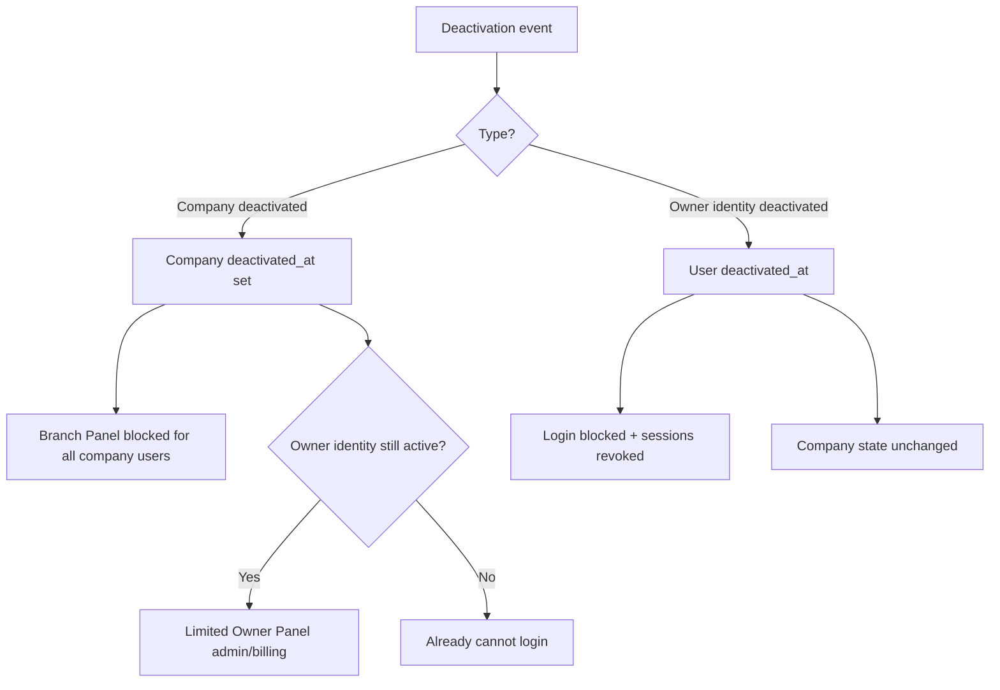

# F — Access Restriction / State Matrix

**Status:** **Approved with documented exceptions** — 22 November 2026 (PO-P2-DESIGN-FORMAL; exact restricted/trial/grace entitlements remain Pending — AUD-CON-006)  
**Traceability:** PRD §§3–5; Rules §2; Design.md §2; DEC-002/003; ADR-002/006; PO-P2-DEACT-_; PO-P2-FILE-_; PO-P2-DESIGN-SWITCHER; PO-P2-DESIGN-LANDING; PO-P2-DESIGN-DEACT-VIEW; PO-P2-DESIGN-SUB-UX; TB-OWN-_; TB-SEC-_; TB-DEL-002; P2-WS-4/6/7

**Rule:** Do not invent access exceptions. Nav visibility ≠ authorization.

## 1. Core panel matrix

| Identity / relationship                                 | Company state              | Owner Panel                                                                                    | Branch Panel                                         | Company context behaviour                          | Nav visibility                                                                                                              | Server authorization expectation                                                | Governing authority                                                       |
| ------------------------------------------------------- | -------------------------- | ---------------------------------------------------------------------------------------------- | ---------------------------------------------------- | -------------------------------------------------- | --------------------------------------------------------------------------------------------------------------------------- | ------------------------------------------------------------------------------- | ------------------------------------------------------------------------- |
| Active Company Owner                                    | Active                     | Full (`full`)                                                                                  | Allowed (all company branches, incl. future)         | Owner scope; may enter branch scope                | Full Owner nav; Branch entry enabled                                                                                        | `isCompanyOwner` + active company for Branch                                    | PRD §4–5; TB-OWN-001/008                                                  |
| Active Company Owner                                    | Deactivated                | Limited: view identity/status + subscription/billing/invoices; no extra writes                 | Blocked                                              | Owner scope limited; no operational branch context | Owner nav limited; Branch entry disabled                                                                                    | Owner Panel exception must not be blanket-denied; Branch deny                   | DEC-002; PO-P2-DEACT-COMPANY; PO-P2-DESIGN-DEACT-VIEW; TB-OWN-002–004     |
| Deactivated Owner identity                              | Active company             | None (no login)                                                                                | None                                                 | N/A                                                | N/A                                                                                                                         | Auth / session fail closed; sessions revoked                                    | PO-P2-DEACT-OWNER; DEC-002                                                |
| Soft-deleted Customer                                   | Any                        | None                                                                                           | None                                                 | N/A                                                | N/A                                                                                                                         | Auth deny                                                                       | DEC-003; TB-DEL-002                                                       |
| Customer member + active membership + branch assignment | Active                     | None                                                                                           | Assigned branches only                               | Branch scope for assigned branch                   | Branch nav for permitted modules                                                                                            | Membership + assignment + role permissions                                      | TB-OWN-007; PRD §5–6                                                      |
| Customer member without branch assignment               | Active                     | None                                                                                           | No for that branch                                   | Cannot activate that branch                        | Branch absent                                                                                                               | Deny branch context                                                             | TB-OWN-007                                                                |
| Customer member                                         | Deactivated company        | None                                                                                           | None for that company                                | May use other active companies                     | Company shown deactivated / unavailable for branch                                                                          | Branch deny for company                                                         | DEC-002; TB-OWN-002                                                       |
| Customer Admin (non-Owner)                              | Active                     | None                                                                                           | Per assignments only                                 | Never Owner scope                                  | No Owner Panel chrome                                                                                                       | Owner Panel deny even with Admin role                                           | PRD §5; TB-OWN-001                                                        |
| Internal Team user                                      | Any customer company       | None (customer panels)                                                                         | None (customer panels)                               | Internal context only                              | Internal surfaces only                                                                                                      | Customer workspace deny; **no customer file access**                            | PO-P2-FILE-INTERNAL; ADR-002                                              |
| Customer in multiple companies                          | Active companies           | Owner Panel only for owned companies (landing per PO-P2-DESIGN-LANDING); never for member-only | Only server-validated selected company + assignments | Active company only for files                      | Unified switcher lists **all** accessible companies with Owner vs Member distinction; owned → OP; member-only → Branch path | Validate every switch; reject client tenant ids                                 | PO-P2-DESIGN-SWITCHER; PO-P2-DESIGN-LANDING; PO-P2-FILE-MULTI; TB-SEC-002 |
| Previous Owner after transfer                           | Transferred company Active | None for that company                                                                          | None for that company                                | Other companies unchanged                          | Company removed from Owner list                                                                                             | Owner designation moved; membership revoked for company                         | P2-WS-7; PRD §4                                                           |
| New Owner after transfer                                | Active                     | Full after re-auth                                                                             | All branches                                         | Sessions invalidated then new session              | Owner Panel available post-login                                                                                            | Designation + session version                                                   | P2-WS-7; ADR-006                                                          |
| Customer with no remaining memberships/ownerships       | N/A                        | None                                                                                           | None                                                 | Soft-delete path when applicable                   | N/A                                                                                                                         | Identity soft-deleted; sessions revoked                                         | TB-DEL-002                                                                |
| Deactivated branch assignment                           | Active company             | N/A                                                                                            | No for that branch                                   | —                                                  | Branch hidden                                                                                                               | Assignment inactive deny                                                        | TB-OWN-007                                                                |
| Deactivated Customer role                               | Active                     | N/A                                                                                            | Access continues only after reassignment rules       | —                                                  | May hide modules                                                                                                            | Deactivated role not newly assigned; reassignment required for continued access | PRD §6                                                                    |

## 2. Decision flow (company deactivation vs identity)

## 3. File access (cross-cutting)

| Actor                 | Rule                                               | Label                    | Authority           |
| --------------------- | -------------------------------------------------- | ------------------------ | ------------------- |
| Internal Team         | No customer-uploaded file access (no admin bypass) | **Approved requirement** | PO-P2-FILE-INTERNAL |
| Customer Owner/member | Only within server-resolved active company context | **Approved requirement** | PO-P2-FILE-MULTI    |
| Client `company_id`   | Never grants file or panel access                  | **Approved requirement** | TB-SEC-002          |

## 4. Session / auth overlays

| Event                                            | Panel effect                                               | Authority         |
| ------------------------------------------------ | ---------------------------------------------------------- | ----------------- |
| Customer web session replaced / version mismatch | Fail closed to login                                       | P2-WS-4; ADR-006  |
| Ownership transfer (new Owner)                   | Must re-authenticate before Owner Panel                    | P2-WS-7           |
| Ownership transfer (previous Owner)              | May remain logged in elsewhere; transferred company denied | P2-WS-7           |
| Password change / identity deactivate            | Session revocation per policy                              | Rules §2; P2-WS-4 |

## 5. Subscription commercial states (presentation principles)

**Approved high-level principles (PO-P2-DESIGN-SUB-UX):**

| State               | Presentation principle                                                                              | Exact entitlements                                                                                  |
| ------------------- | --------------------------------------------------------------------------------------------------- | --------------------------------------------------------------------------------------------------- |
| Active              | Normal access, subject to applicable entitlements                                                   | Per governing subscription rules                                                                    |
| Trial               | Access governed by approved trial entitlements                                                      | Rules §15: first-company trial; configurable limits; Owner Panel remains; **do not invent further** |
| Grace               | Access governed by approved grace-period permissions                                                | Rules §15: paid grace view-only; Owner Panel remains; **exact chrome Pending where not stated**     |
| Restricted          | Access governed by applicable restriction rules                                                     | **Pending Product Owner Decision** for exact permissions (AUD-CON-006)                              |
| Suspended           | Branch Panel blocked; Owner billing and subscription information remains accessible                 | **Approved requirement** (Rules §15; PO-P2-DESIGN-SUB-UX)                                           |
| Company deactivated | Branch Panel blocked; Owner Panel limited to approved company administration and billing visibility | **Approved requirement** (DEC-002; PO-P2-DESIGN-DEACT-VIEW)                                         |

**Clarification (design handoff):** Do not invent a separate panel mode named “Expired.” End of paid period maps through Rules §15 grace → restriction / suspension behaviour. Exact restricted entitlements remain **Pending** (AUD-CON-006).

Do **not** invent or infer exact trial/grace/restricted permissions beyond governing text. Keep unresolved cells out of implementation scope.

## 6. Resolved baseline decisions

| Former ID | Resolution                                                                       | Decision ID           |
| --------- | -------------------------------------------------------------------------------- | --------------------- |
| OQ-AX-02  | Unified switcher lists all accessible companies with Owner vs Member distinction | PO-P2-DESIGN-SWITCHER |

## 7. Remaining Pending (explicitly not fully approved)

| ID                     | Question                                                              | Binding decision                                                          |
| ---------------------- | --------------------------------------------------------------------- | ------------------------------------------------------------------------- |
| OQ-AX-01 / AUD-CON-006 | Exact entitlement permissions for trial, grace, and restricted states | PO-DEC-P2-REVIEW-001 — **APPROVED WITH EXCEPTION** (defer; do not invent) |

## 8. Out of scope

- Inventing new privilege paths
- Soft-restore / hard-delete exceptions (prohibited)
- Mobile multi-channel session matrix beyond ADR-006 web-only Phase 2 posture
