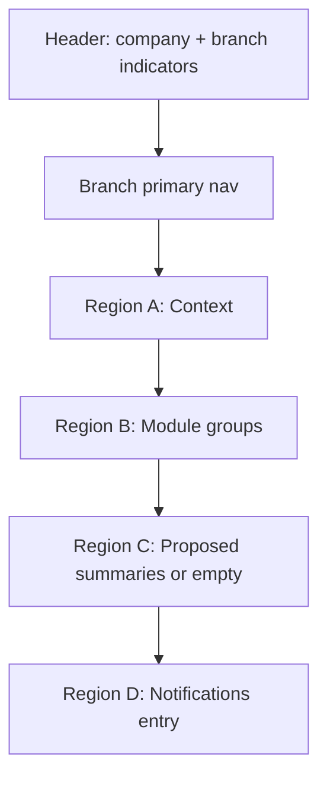

# E — Branch Dashboard Key-Screen Design

**Status:** Draft — Awaiting Product Owner Review  
**Traceability:** Design.md §§1–3, 2, 13; PRD §5; TB-OWN-007/008; DEC-002

## 1. Purpose

Branch Panel home for a server-validated company + branch. Provides orientation and navigation into approved module groups. **Does not** invent operational metrics or imply existing dashboard data sources.

## 2. Brand and shell

Same brand constraints as Owner Dashboard (Poppins, light-first, gradient accents, logo, a11y) — **Approved requirement** (Design.md §1, §13; DEC-007).

## 3. Page structure (wireframe)

```text
+------------------------------------------------------------------+
| [Logo]  Branch Panel   Company: {Name}   Branch: {Name}
|                        Status: Active
|  [Branch switcher v]   [Owner Panel] (Owners only)   [User menu]
+------------------------------------------------------------------+
| Nav: Dashboard | Enquiry | Operations | Accounting | Assets |
|      Masters | Notifications | Settings                           |
+------------------------------------------------------------------+
| Page title: Branch Dashboard                                       |
+------------------------------------------------------------------+
| Region A: Branch context reminder                                  |
| Region B: Module launch groups (nav cards / links)                 |
| Region C: Operational summary placeholders (labelled)              |
| Region D: Notifications preview entry (optional)                   |
+------------------------------------------------------------------+
```



## 4. Regions

### Region A — Branch context (**Design interpretation**)

- Company name, branch name, Active status text
- Optional role label — **Proposal**

### Region B — Module launch groups (**Approved requirement** for group labels)

Cards or link groups matching Design.md §2:

| Group         | Contents                                                           | Implementation note    |
| ------------- | ------------------------------------------------------------------ | ---------------------- |
| Enquiry       | Enquiry list entry                                                 | Module UI later phases |
| Operations    | Consignment/LR, Broker, OwnFleet, Partload                         | Module UI later phases |
| Accounting    | Accounting hub entry                                               | Module UI later phases |
| Assets        | Vehicle docs, Tyres, Batteries, Maintenance, Spare Parts, Workshop | Module UI later phases |
| Masters       | Masters hub                                                        | Module UI later phases |
| Notifications | Centre entry                                                       | Design.md §9           |
| Settings      | Branch/user settings without banned self-service actions           | DEC-006/009            |

Undeveloped modules may show “Coming in a later phase” (**Design interpretation**) or be hidden (**Proposal** — OQ-BP-03).

### Region C — Operational summary

| Widget                  | Status                                                                 |
| ----------------------- | ---------------------------------------------------------------------- |
| Open enquiries count    | **Proposal — Product Owner decision required**                         |
| In-progress trips / LRs | **Proposal — Product Owner decision required**                         |
| Charts                  | **Not approved** — omit                                                |
| Empty placeholder       | “Branch summaries appear here when metrics are approved and available” | **Design interpretation** |

No fabricated values in review materials.

### Region D — Notifications entry (**Design interpretation**)

Link to notification centre; unread badge only if server provides count. Mandatory subscription alerts behaviour belongs to Owner/subscription surfaces more than Branch Dashboard (**Approved requirement** for mandatory alerts existence; placement detail **Design interpretation**).

## 5. Permission-restricted behaviour

| Case                             | UX                                 | Label                                           |
| -------------------------------- | ---------------------------------- | ----------------------------------------------- |
| Module not permitted             | Group hidden or disabled with text | **Approved requirement** (hide) + server deny   |
| Company deactivated              | Page unreachable                   | **Approved requirement**                        |
| Branch deactivated / unassigned  | Deny                               | **Approved requirement**                        |
| Subscription blocks Branch Panel | Unavailable whole panel            | **Approved requirement** (Rules §15 suspension) |

## 6. Responsive layout

| Breakpoint      | Behaviour                                       | Label                                      |
| --------------- | ----------------------------------------------- | ------------------------------------------ |
| Desktop         | Sidebar + module grid                           | **Design interpretation**                  |
| Tablet          | Collapsible nav; 2-column cards                 | **Design interpretation**                  |
| Critical mobile | Stacked module list; branch switcher accessible | **Approved requirement** (critical mobile) |

## 7. States

| State         | Spec                                                    | Label                     |
| ------------- | ------------------------------------------------------- | ------------------------- |
| Loading       | Skeleton module grid                                    | **Design interpretation** |
| Empty         | No modules available → explain permissions/entitlements | **Design interpretation** |
| Error         | Retry without inventing KPIs                            | **Design interpretation** |
| Access denied | Standard denial                                         | **Approved requirement**  |

## 8. Open questions

| ID       | Question                                                    |
| -------- | ----------------------------------------------------------- |
| OQ-BD-01 | Which, if any, summary widgets are approved for Phase 2 UI? |
| OQ-BD-02 | Hide vs “coming later” for undeveloped module groups        |
| OQ-BD-03 | Show Owner Panel control on mobile sticky header?           |

## 9. Out of scope

- Dashboard query services, aggregations, seed data
- Detailed module screens
- Product React implementation
