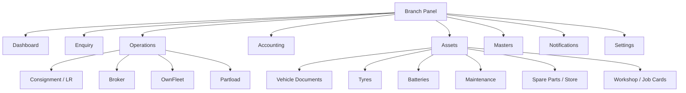
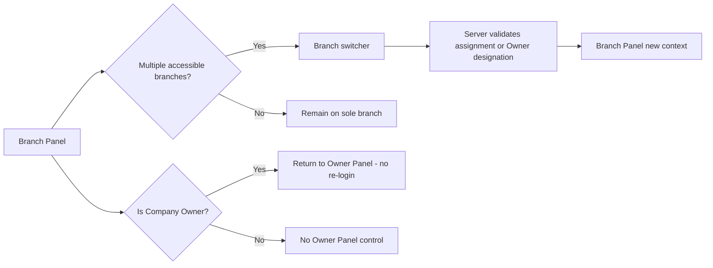

# B — Branch Panel Information Architecture

**Status:** Draft — Awaiting Product Owner Review  
**Traceability:** Design.md §2; PRD §§5–6; Rules §2–3; TB-OWN-007/008; TB-RBAC-*; DEC-002

## 1. Purpose and context

| Item                 | Content                                                                                                                                       | Label                              |
| -------------------- | --------------------------------------------------------------------------------------------------------------------------------------------- | ---------------------------------- |
| Purpose              | Operational workspace for a single server-validated company + branch                                                                          | **Approved requirement**           |
| Who may enter        | Active Customer with Owner designation for the company, or active membership with an explicit active branch assignment (and applicable roles) | **Approved requirement**           |
| Company prerequisite | Company must be active for Branch Panel operations                                                                                            | **Approved requirement** (DEC-002) |
| Non-goals            | Owner-only company admin, subscription mutation, Permission Master definition editing                                                         | **Approved requirement**           |

Server-side authorization is authoritative. Navigation visibility is UX only (**Approved requirement**, Design.md §2).

## 2. Branch context indicator

Every Branch Panel screen shows:

| Element        | Content                                                                                        | Label                                                  |
| -------------- | ---------------------------------------------------------------------------------------------- | ------------------------------------------------------ |
| Company name   | Active company (server context)                                                                | **Design interpretation**                              |
| Branch name    | Current branch                                                                                 | **Approved requirement** / **Design interpretation**   |
| Company status | Active only for operational Branch Panel; if somehow reached while deactivated → access denied | **Approved requirement**                               |
| Role hint      | Optional current primary role label for the branch                                             | **Proposal** (helpful; not required by governing text) |

## 3. Navigation hierarchy (Design.md §2 starting point)

### Group notes

| Group                                                | Phase 2 design treatment                                                               | Label                                                                            |
| ---------------------------------------------------- | -------------------------------------------------------------------------------------- | -------------------------------------------------------------------------------- |
| Dashboard                                            | Entry hub; see Branch Dashboard spec                                                   | **Approved requirement** (nav); content widgets largely **Proposal**/placeholder |
| Enquiry / Operations / Accounting / Assets / Masters | Navigation groups reserved per Design.md §2                                            | **Approved requirement** for IA labels                                           |
| Module screens                                       | Detailed business screens                                                              | **Out of scope** for Phase 2 design depth (later phases)                         |
| Notifications                                        | Bell + centre patterns in Design.md §9                                                 | **Approved requirement** for entry; full centre **Out of scope** depth           |
| Settings                                             | Branch-scoped user preferences that do not include self email change or account delete | **Approved requirement** (DEC-006/009)                                           |
| Partload Expense Management UI                       | Explicitly out of scope                                                                | **Out of scope** (DEC-005)                                                       |

## 4. Role / permission-dependent visibility

| Rule                    | Behaviour                                                                                     | Label                                   |
| ----------------------- | --------------------------------------------------------------------------------------------- | --------------------------------------- |
| Hide inaccessible items | Nav omits modules/actions the role cannot use                                                 | **Approved requirement** (Design.md §2) |
| Server still decides    | Direct URL / forged request denied by backend                                                 | **Approved requirement**                |
| Deactivated role        | Cannot be newly assigned; existing users must be reassigned before continued branch access    | **Approved requirement** (PRD §6)       |
| Delete                  | Never implied by Admin/Owner labels; only explicit Delete permission                          | **Approved requirement** (TB-RBAC-001)  |
| Owner in Branch Panel   | Sees all operational groups permitted by product rules for Owner; no assignment rows required | **Approved requirement** (TB-OWN-008)   |
| Non-Owner               | Only assigned branch(es); unassigned branches absent and denied                               | **Approved requirement** (TB-OWN-007)   |

## 5. Branch switching and Owner Panel return

| Control                              | Who sees it                                                                        | Label                                   |
| ------------------------------------ | ---------------------------------------------------------------------------------- | --------------------------------------- |
| Branch switcher                      | Users with >1 accessible branch in the active company                              | **Approved requirement** (PRD §5)       |
| Return to Owner Panel                | Company Owner only                                                                 | **Approved requirement** (Design.md §2) |
| Company switcher inside Branch Panel | **Proposal:** Owners may switch company only via Owner Panel to keep context clear | **Proposal**                            |

## 6. Empty / unavailable / access-denied states

| State                              | Behaviour                                                                                     | Label                                                                                             |
| ---------------------------------- | --------------------------------------------------------------------------------------------- | ------------------------------------------------------------------------------------------------- |
| Loading                            | Light skeleton; branch context chrome retained when known                                     | **Design interpretation**                                                                         |
| Empty module                       | Standard empty pattern (Design.md §3); no fabricated rows                                     | **Approved requirement** / **Design interpretation**                                              |
| Module not entitled (subscription) | Unavailable state with text reason; Owner directed toward Owner Panel billing when applicable | **Approved requirement** (Rules §15 suspension/restriction); exact copy **Design interpretation** |
| Company deactivated                | Branch Panel blocked entirely                                                                 | **Approved requirement** (DEC-002)                                                                |
| No branch assignment               | Non-Owner cannot open Branch Panel for that branch                                            | **Approved requirement**                                                                          |
| Permission denied                  | Inline or page-level denial; no leak of protected record data                                 | **Approved requirement**                                                                          |

## 7. Open questions

| ID       | Question                                                                                      | Affects                               |
| -------- | --------------------------------------------------------------------------------------------- | ------------------------------------- |
| OQ-BP-01 | Company switcher inside Branch Panel vs Owner Panel only                                      | Header chrome                         |
| OQ-BP-02 | Whether “Settings” is branch prefs only or includes limited company read-only links for Owner | Settings group                        |
| OQ-BP-03 | Which Phase 2 modules show as “Coming later” vs hidden entirely in nav                        | Nav inventory for undeveloped modules |

## 8. Out of scope

- Detailed Enquiry/LR/Broker/OwnFleet/Partload/Accounting/Asset screen designs
- Internal Team CRM navigation
- Product implementation
