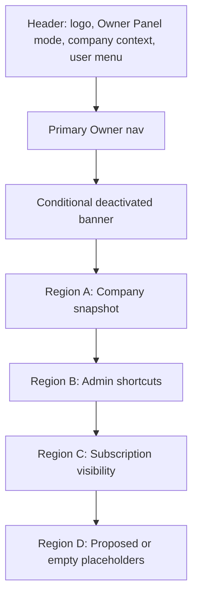

# D — Owner Dashboard Key-Screen Design

**Status:** Draft — Awaiting Product Owner Review  
**Traceability:** Design.md §§1–3, 8, 13; PRD §§5, 19; DEC-002; TB-DES-001

## 1. Purpose

Primary Owner Panel home after login / company context activation. Orients the Owner to company administration and billing visibility. **Does not** invent operational KPIs.

## 2. Brand and shell

| Rule             | Application                                                          | Label                                    |
| ---------------- | -------------------------------------------------------------------- | ---------------------------------------- |
| Light-first page | White / `#F8F9FA` / `#F5F7FA` surfaces; no dark full-page background | **Approved requirement**                 |
| Poppins          | All UI text                                                          | **Approved requirement** (DEC-007)       |
| Gradient accent  | `#2FB36F` → `#2D8CFF` for brand marks / primary accents only         | **Approved requirement**                 |
| Logo             | Official TruckBill mark in shell header                              | **Approved requirement**                 |
| Focus / contrast | Visible focus ring; accessible contrast                              | **Approved requirement** (Design.md §13) |
| Technical shell  | Reuse app sidebar/header patterns from existing shell                | **Design interpretation**                |

## 3. Page structure (wireframe)

```text
+------------------------------------------------------------------+
| [Logo]  Owner Panel     Company: {Name}  Status: {Active|Deactivated}
|          [Company switcher v]              [User menu]
+------------------------------------------------------------------+
| Nav: Dashboard | Branches | Users | Settings | Subscription | Audit |
|      [Enter Branch Panel]                                            |
+------------------------------------------------------------------+
| Page title: Owner Dashboard                                          |
| Optional banner (deactivated company only)                           |
+------------------------------------------------------------------+
| Region A: Company snapshot (identity + status)                       |
| Region B: Administration shortcuts                                   |
| Region C: Subscription / billing visibility                          |
| Region D: Placeholders / proposed widgets (explicitly labelled)      |
+------------------------------------------------------------------+
| Footer / help                                                        |
+------------------------------------------------------------------+
```



## 4. Regions

### Region A — Company snapshot (**Design interpretation**)

| Element                     | Source expectation   | Label                                        |
| --------------------------- | -------------------- | -------------------------------------------- |
| Company name                | Server context       | **Approved requirement**                     |
| Status text + badge         | Active / Deactivated | **Approved requirement** (non-colour status) |
| Owner identity display name | Authenticated user   | **Design interpretation**                    |

### Region B — Administration shortcuts (**Design interpretation**)

Links only (no fabricated counts):

- Branches
- Users & memberships
- Company settings
- Company audit

### Region C — Subscription / billing visibility (**Approved requirement** for presence)

| Element                                                            | Notes                                                                  | Label                                   |
| ------------------------------------------------------------------ | ---------------------------------------------------------------------- | --------------------------------------- |
| Contract / renewal date                                            | Show when data exists; otherwise empty state                           | **Approved requirement** (Design.md §8) |
| Modules / add-ons summary                                          | Names/status text only when available                                  | **Approved requirement**                |
| Capacity / storage / credits                                       | Visibility reserved; no invented numbers                               | **Approved requirement**                |
| Trial / grace / restricted / suspended / deactivated commercial UX | Consolidated matrix still **Pending** (AUD-CON-006 / TB-SUB-STATE-001) | **Pending**                             |

### Region D — Metrics / charts / recent activity

| Widget                          | Status                                                                                                     |
| ------------------------------- | ---------------------------------------------------------------------------------------------------------- |
| Revenue / trip / enquiry charts | **Not approved** — leave empty or omit                                                                     |
| “Recent activity” feed          | **Proposal — Product Owner decision required** (needs event list definition)                               |
| Seat/branch usage gauges        | **Proposal — Product Owner decision required** (may mirror subscription capacity once Phase 3 data exists) |
| Placeholder panel               | “Insights will appear here when approved”                                                                  | **Design interpretation** for empty |

**Do not** seed fabricated metrics in design review materials presented as real.

## 5. Deactivated company variant

| Element             | Behaviour                                                                                                      | Label                                  |
| ------------------- | -------------------------------------------------------------------------------------------------------------- | -------------------------------------- |
| Banner              | “Company is Deactivated. Branch Panel is unavailable. Administrative and billing information remains visible.” | **Approved requirement** (DEC-002)     |
| Enter Branch Panel  | Disabled + text reason                                                                                         | **Approved requirement**               |
| Regions A–C         | Limited to admin/billing information                                                                           | **Approved requirement**               |
| Extra write actions | None invented                                                                                                  | **Pending** exhaustive list (OQ-OP-03) |

## 6. Responsive layout

| Breakpoint      | Behaviour                                                                | Label                                                  |
| --------------- | ------------------------------------------------------------------------ | ------------------------------------------------------ |
| Desktop         | Sidebar + multi-column regions                                           | **Design interpretation** (Design.md §13)              |
| Tablet          | Collapsible nav; stacked regions                                         | **Design interpretation**                              |
| Critical mobile | Single column; company switcher reachable; primary admin links available | **Approved requirement** for critical mobile behaviour |

## 7. States

| State                   | Spec                                                                          | Label                                   |
| ----------------------- | ----------------------------------------------------------------------------- | --------------------------------------- |
| Loading                 | Skeleton for regions A–C; no fake numbers                                     | **Design interpretation**               |
| Empty subscription data | Explicit empty copy in Region C                                               | **Design interpretation**               |
| Error                   | Page-level error with retry                                                   | **Design interpretation**               |
| Unavailable             | Entitlement/suspension messaging without inventing matrix cells still Pending | **Pending** + **Design interpretation** |
| Access denied           | Non-Owner never reaches this page                                             | **Approved requirement**                |

## 8. Open questions

| ID       | Question                                                                       |
| -------- | ------------------------------------------------------------------------------ |
| OQ-OD-01 | Approve any dashboard widget beyond admin shortcuts + subscription visibility? |
| OQ-OD-02 | Same as OQ-OP-03 for deactivated write actions reachable from dashboard        |
| OQ-OD-03 | Is Owner Dashboard distinct from a “Companies list” home?                      |

## 9. Out of scope

- Dashboard aggregation APIs, queries, seed data
- React page implementation
- Phase 3 checkout UI detail
