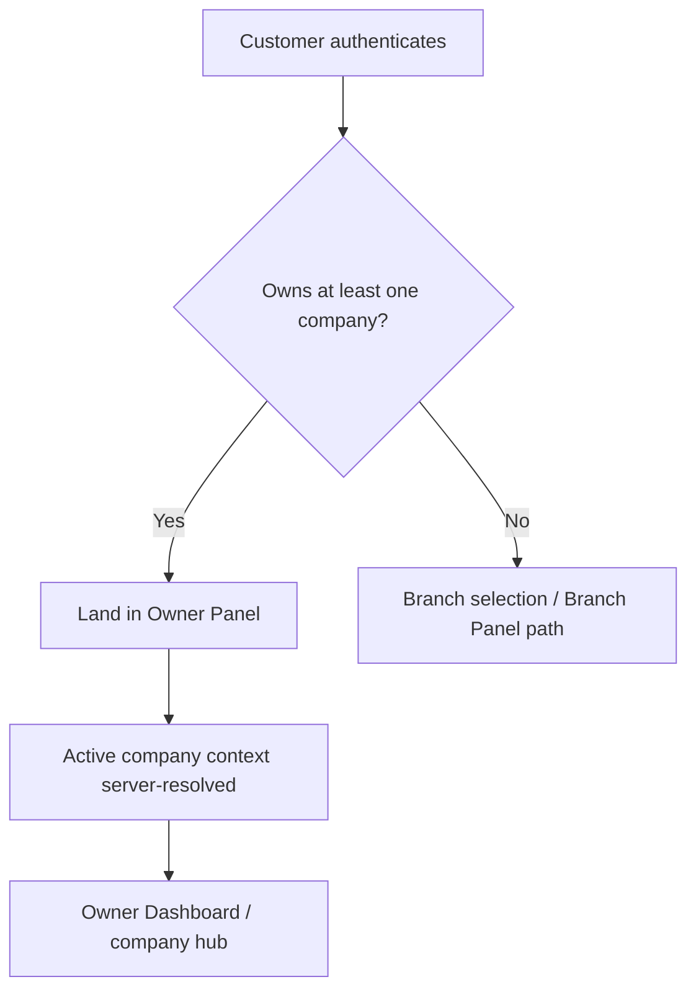
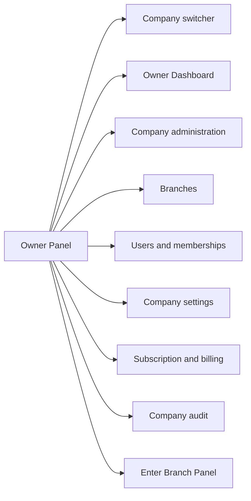

# A — Owner Panel Information Architecture

**Status:** **Approved with documented exceptions** — 22 November 2026 (PO-P2-DESIGN-FORMAL; AUD-CON-006 cells remain Pending)  
**Traceability:** PRD §§4–5, 19; Rules §2; Design.md §§2, 8; DEC-002; PO-P2-DEACT-COMPANY; TB-OWN-001–005

## 1. Purpose and user boundary

| Item               | Content                                                                                                                                                              | Label                                         |
| ------------------ | -------------------------------------------------------------------------------------------------------------------------------------------------------------------- | --------------------------------------------- |
| Purpose            | Company-level administration surface for the designated Company Owner: companies, branches, users/memberships, company settings, subscription/billing, company audit | **Approved requirement**                      |
| Who may enter      | Only the identity that holds `companies.owner_user_id` for the selected company, and that identity must be an active Customer (login-capable)                        | **Approved requirement** (PRD §5; TB-OWN-001) |
| Who must not enter | Customer Admin and all other Customer roles; Internal Team; previous Owner after ownership transfer; deactivated Owner identity                                      | **Approved requirement**                      |
| Ordinary roles     | Operational role permissions never grant Owner Panel                                                                                                                 | **Approved requirement** (PRD §5)             |

## 2. Entry and default landing

- **Approved requirement:** Owner always lands in Owner Panel (PRD §5).
- **Approved requirement (PO-P2-DESIGN-LANDING):** If the user owns exactly one company → that company's Owner Panel. If the user owns multiple companies → most recently used owned company. If no previous owned-company selection exists → owned-company selection screen. Member-only companies must never be the default Owner Panel context.

## 3. Navigation hierarchy

### 3.1 Unified company / workspace switcher

| Element                    | Behaviour                                                                                               | Label                                                        |
| -------------------------- | ------------------------------------------------------------------------------------------------------- | ------------------------------------------------------------ |
| Switcher content           | Lists **all** companies the signed-in Customer can access                                               | **Approved requirement** (PO-P2-DESIGN-SWITCHER)             |
| Owner vs Member            | Clearly distinguish designated Owner companies from membership-only companies                           | **Approved requirement** (PO-P2-DESIGN-SWITCHER)             |
| Select owned company       | Opens that company's Owner Panel                                                                        | **Approved requirement** (PO-P2-DESIGN-SWITCHER)             |
| Select member-only company | Proceeds to Branch Panel access for an explicitly accessible branch; never exposes Owner Panel controls | **Approved requirement** (PO-P2-DESIGN-SWITCHER)             |
| Selection effect           | Server validates every company/branch selection; UI never treats client ids as authority                | **Approved requirement** (TB-SEC-002; PO-P2-DESIGN-SWITCHER) |
| Active indicator           | Show active company name + status text (Active / Deactivated) with non-colour status                    | **Approved requirement** + **Design interpretation**         |
| File access                | Customer-uploaded files scoped to server-resolved active company only                                   | **Approved requirement** (PO-P2-FILE-MULTI)                  |

### 3.2 Company administration

Entry points (navigation labels — **Design interpretation**):

| Nav item                    | Intent                                                       | Label                                                                               |
| --------------------------- | ------------------------------------------------------------ | ----------------------------------------------------------------------------------- |
| Companies                   | View/manage Owner’s companies (create flow is product-gated) | **Approved requirement** (PRD §5)                                                   |
| Company profile             | Legal/tax/contact settings for active company                | **Approved requirement** (PRD company master)                                       |
| Data visibility / numbering | Company-level configuration entry                            | **Approved requirement** (PRD); detailed screens **Out of scope** for this IA depth |

### 3.3 Branch administration entry points

| Nav item     | Intent                                                                        | Label                                           |
| ------------ | ----------------------------------------------------------------------------- | ----------------------------------------------- |
| Branches     | List company branches; create/edit branch (no user management on branch edit) | **Approved requirement** (PRD §3)               |
| Enter branch | Owner selects a branch and enters Branch Panel without re-login               | **Approved requirement** (PRD §5; Design.md §2) |

Owner automatically accesses all current and future branches — no assignment rows required (**Approved requirement**, TB-OWN-008).

### 3.4 Users and memberships

| Nav item                  | Intent                                                                                              | Label                                           |
| ------------------------- | --------------------------------------------------------------------------------------------------- | ----------------------------------------------- |
| Users                     | Add/invite users; name, email, mobile, password, company/branch, branch-specific role               | **Approved requirement** (PRD §3; PO-P2-INVITE) |
| Memberships / assignments | View membership and branch assignments; deactivate membership (not Owner designation)               | **Approved requirement**                        |
| Roles                     | Assign active Customer roles to branch assignments; Owner cannot edit Permission Master definitions | **Approved requirement** (PRD §6)               |

Password of an existing identity is never overwritten on attach (**Approved requirement**).

### 3.5 Company settings

| Area                        | Notes                                                           | Label                              |
| --------------------------- | --------------------------------------------------------------- | ---------------------------------- |
| Company settings hub        | Groups profile, visibility, numbering, documents/logo/signature | **Design interpretation**          |
| Self-service email change   | Must not appear                                                 | **Approved requirement** (DEC-009) |
| Self-service account delete | Must not appear                                                 | **Approved requirement** (DEC-006) |

### 3.6 Subscription and billing visibility

| Area                         | Notes                                                                                  | Label                                                                                          |
| ---------------------------- | -------------------------------------------------------------------------------------- | ---------------------------------------------------------------------------------------------- |
| Subscription overview        | Active modules/add-ons, contract, common renewal date, capacity, usage, storage        | **Approved requirement** (Design.md §8; PRD §19)                                               |
| Billing / invoices / credits | Payment history, invoice number approval surfaces, Broker/Partload and service credits | **Approved requirement** (Design.md §8)                                                        |
| Checkout / Razorpay          | Phase 3 commercial delivery; Owner Panel IA reserves the entry point                   | **Approved requirement** for visibility; **Out of scope** for Phase 2 UI implementation detail |
| Ownership transfer effect    | Contract remains company-bound; new Owner receives billing access                      | **Approved requirement** (Rules §15)                                                           |

Do not imply auto-renewal for the initial manual renewal delivery (**Approved requirement**, Phases.md Phase 3).

### 3.7 Company-level audit

| Area                      | Notes                                                      | Label                                   |
| ------------------------- | ---------------------------------------------------------- | --------------------------------------- |
| Company audit             | Read-oriented company audit entry for Owner                | **Approved requirement** (Design.md §2) |
| Remark-required mutations | Edit/delete/cancel confirmation patterns from Design.md §3 | **Approved requirement**                |

## 4. Active vs deactivated company presentation

| Company state | Owner Panel                                | Branch Panel from Owner Panel                | Presentation                                                    | Label                                                   |
| ------------- | ------------------------------------------ | -------------------------------------------- | --------------------------------------------------------------- | ------------------------------------------------------- |
| Active        | Full Owner Panel scope (`full`)            | Allowed (Owner may enter any company branch) | Status: Active (text + badge)                                   | **Approved requirement**                                |
| Deactivated   | Limited Owner Panel (`admin_billing_only`) | Blocked                                      | Status: Deactivated; banner explaining Branch Panel unavailable | **Approved requirement** (DEC-002; PO-P2-DEACT-COMPANY) |

### Limited Owner Panel while company deactivated

**Approved requirement (PO-P2-DEACT-COMPANY; PO-P2-DESIGN-DEACT-VIEW):**

- Permit viewing company identity and status information.
- Permit viewing subscription, billing, and invoice information.
- Block Branch Panel and operational modules.
- Do **not** introduce additional write actions unless separately approved.
- Do **not** confuse company deactivation with Owner identity deactivation.

### Owner identity deactivation

Distinct from company deactivation (**Approved requirement**, DEC-002 / PO-P2-DEACT-OWNER):

- Deactivated Owner identity cannot log in.
- Owner Panel inaccessible.
- Sessions revoked via approved session policy.

## 5. Page relationships (Owner Panel)

| From            | To                                                 | How                                                              | Label                                            |
| --------------- | -------------------------------------------------- | ---------------------------------------------------------------- | ------------------------------------------------ |
| Owner Dashboard | Branches / Users / Settings / Subscription / Audit | Primary nav                                                      | **Design interpretation**                        |
| Owner Panel     | Branch Panel                                       | Explicit “Open branch” / branch picker; no new login             | **Approved requirement**                         |
| Branch Panel    | Owner Panel                                        | Persistent “Owner Panel” control for Owners                      | **Approved requirement** (Design.md §2)          |
| Owner Panel     | Another accessible company                         | Unified switcher → owned opens OP; member-only opens Branch path | **Approved requirement** (PO-P2-DESIGN-SWITCHER) |

## 6. Empty / loading / error / denied states

| State                 | Owner Panel behaviour                                                                              | Label                                           |
| --------------------- | -------------------------------------------------------------------------------------------------- | ----------------------------------------------- |
| Loading               | Skeleton shell; retain brand light surface                                                         | **Design interpretation** (Design.md §3)        |
| Empty owned companies | If user has no owned companies, do not land in Owner Panel; use member Branch path or no-workspace | **Approved requirement** (PO-P2-DESIGN-LANDING) |
| Access denied         | Non-Owner hitting Owner routes → deny; no Owner chrome                                             | **Approved requirement**                        |
| Server error          | Recoverable error with retry; no fabricated data                                                   | **Design interpretation**                       |
| Deactivated company   | Banner + limited nav; Branch entry disabled with text reason                                       | **Approved requirement**                        |

## 7. Resolved baseline decisions (this artefact)

| Former ID | Resolution                                                                                                 | Decision ID             |
| --------- | ---------------------------------------------------------------------------------------------------------- | ----------------------- |
| OQ-OP-01  | Unified switcher lists all accessible companies with Owner vs Member distinction                           | PO-P2-DESIGN-SWITCHER   |
| OQ-OP-02  | One owned → that OP; many owned → MRU owned; else owned-company selection; never member-only as OP default | PO-P2-DESIGN-LANDING    |
| OQ-OP-03  | Deactivated company: view identity/status + subscription/billing/invoices; no extra writes; Branch blocked | PO-P2-DESIGN-DEACT-VIEW |
| OQ-OP-04  | Owner Dashboard content limited to approved admin/billing regions                                          | PO-P2-DESIGN-DASH       |

## 8. Remaining Pending (do not invent)

| ID          | Topic                                                | Notes                                                                 |
| ----------- | ---------------------------------------------------- | --------------------------------------------------------------------- |
| AUD-CON-006 | Exact trial/grace/restricted entitlement permissions | High-level only (PO-P2-DESIGN-SUB-UX; PO-DEC-P2-REVIEW-001 exception) |

## 8a. Resolved at formal approval

| Former topic                  | Resolution                                      | Decision ID          |
| ----------------------------- | ----------------------------------------------- | -------------------- |
| MRU owned-company persistence | Server-side; revalidate; never client-authorize | PO-DEC-P2-REVIEW-006 |

## 9. Out of scope for this artefact

- Internal Team IA
- Detailed subscription checkout screens (Phase 3)
- Product React implementation
- Invented metrics or operational module screens inside Owner Panel
