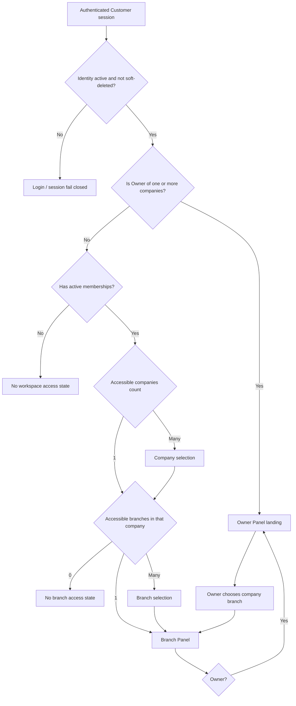
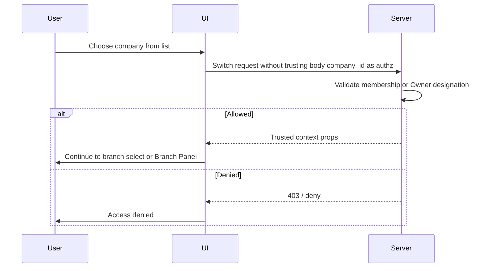

# C — Workspace / Company Selection Flow

**Status:** Draft — Awaiting Product Owner Review  
**Traceability:** PRD §§3–5; Design.md §2; ADR-002; TB-SEC-001/002; DEC-002; PO-P2-DEACT-*; PO-P2-FILE-MULTI; P2-WS-7 ownership transfer

## 1. Security rule (must appear in every selection UI)

**Approved requirement:** UI selection is a _request_ for context, never authorization authority.

- Server resolves active company and branch from authenticated identity, Owner designation and memberships.
- Client-supplied `company_id` / `branch_id` / `owner_id` must be rejected (`RejectClientTenantIdentifiers`).
- Successful switch returns server-validated context indicators only.

## 2. Actors and capabilities (summary)

| Actor                            | Post-login intent                                            | Label                                 |
| -------------------------------- | ------------------------------------------------------------ | ------------------------------------- |
| Company Owner                    | Owner Panel first                                            | **Approved requirement**              |
| Non-Owner, one accessible branch | Direct Branch Panel                                          | **Approved requirement**              |
| Non-Owner, multiple branches     | Branch selection then Branch Panel                           | **Approved requirement**              |
| Multi-company Customer           | Select company (and branch as needed) with server validation | **Approved requirement**              |
| Deactivated Owner identity       | Cannot authenticate                                          | **Approved requirement**              |
| Soft-deleted / no memberships    | Cannot authenticate / no workspace                           | **Approved requirement** (TB-DEL-002) |

## 3. Master decision flow

## 4. Scenario catalogue

### 4.1 One company, one accessible branch (non-Owner)

| Step    | Screen / state                                                      | Label                     |
| ------- | ------------------------------------------------------------------- | ------------------------- |
| 1       | Login                                                               | Shell                     |
| 2       | Server resolves sole company + sole branch                          | **Approved requirement**  |
| 3       | Branch Panel (no selection UI)                                      | **Approved requirement**  |
| Loading | Brief context resolution spinner                                    | **Design interpretation** |
| Error   | Fail closed to safe error; no partial tenant chrome from client ids | **Approved requirement**  |

### 4.2 Customer with multiple companies

| Step              | Screen / state                                                       | Label                                                                                                  |
| ----------------- | -------------------------------------------------------------------- | ------------------------------------------------------------------------------------------------------ |
| 1                 | Login                                                                |                                                                                                        |
| 2                 | If Owner of any → Owner Panel (see 4.3); else company selection list | **Approved requirement** + **Pending** default when also Owner of some and member of others (OQ-OP-01) |
| 3                 | User selects company → server validates                              | **Approved requirement**                                                                               |
| 4                 | Branch path per branch count                                         | **Approved requirement**                                                                               |
| Context indicator | Active company name after selection                                  | **Design interpretation**                                                                              |

### 4.3 Company Owner entering Owner Panel

| Step        | Behaviour                               | Label                                                         |
| ----------- | --------------------------------------- | ------------------------------------------------------------- |
| Post-login  | Owner Panel for default owned company   | **Approved requirement**; default rule **Pending** (OQ-OP-02) |
| Multi-owned | Company switcher inside Owner Panel     | **Approved requirement**                                      |
| Denied      | Non-Owner never sees Owner Panel chrome | **Approved requirement**                                      |

### 4.4 Owner selects company and enters Branch Panel

| Step                | Behaviour                                              | Label                                 |
| ------------------- | ------------------------------------------------------ | ------------------------------------- |
| 1                   | In Owner Panel, choose company (if needed)             | **Approved requirement**              |
| 2                   | Choose branch (Owner sees all active branches)         | **Approved requirement** (TB-OWN-008) |
| 3                   | Branch Panel opens; Owner Panel return control visible | **Approved requirement**              |
| Deactivated company | Branch entry disabled with Deactivated status text     | **Approved requirement** (DEC-002)    |

### 4.5 Owner returns to Owner Panel without logging in again

| Step    | Behaviour                                                  | Label                                                 |
| ------- | ---------------------------------------------------------- | ----------------------------------------------------- |
| Control | Persistent “Owner Panel” in Branch Panel chrome for Owners | **Approved requirement** (Design.md §2)               |
| Session | Same Customer web session; no re-auth                      | **Approved requirement**                              |
| Context | Server may clear branch scope and restore Owner scope      | **Design interpretation** aligned with `isOwnerScope` |

### 4.6 Non-Owner with one accessible branch

Same as 4.1 for that company. If multiple companies but one branch total → company implied or selected then direct Branch Panel (**Design interpretation**).

### 4.7 Non-Owner with multiple explicitly assigned branches

| Step             | Behaviour                          | Label                                 |
| ---------------- | ---------------------------------- | ------------------------------------- |
| Branch selection | List only assigned active branches | **Approved requirement**              |
| Future branches  | Not listed; server denies          | **Approved requirement** (TB-OWN-007) |
| Switch later     | Branch switcher in Branch Panel    | **Approved requirement**              |

### 4.8 User whose company is deactivated

| Actor                   | Behaviour                                                                                      | Label                                                   |
| ----------------------- | ---------------------------------------------------------------------------------------------- | ------------------------------------------------------- |
| Owner (active identity) | Owner Panel limited (`admin_billing_only`); Branch Panel blocked; company shown as Deactivated | **Approved requirement** (DEC-002; PO-P2-DEACT-COMPANY) |
| Member                  | No Branch Panel for that company; may use other active companies                               | **Approved requirement**                                |
| Banner                  | Text status + explanation; not colour alone                                                    | **Approved requirement**                                |

### 4.9 User whose Owner identity is deactivated

| Behaviour                                | Label                                        |
| ---------------------------------------- | -------------------------------------------- |
| Cannot log in; existing sessions revoked | **Approved requirement** (PO-P2-DEACT-OWNER) |
| No Owner Panel                           | **Approved requirement**                     |
| Distinct from company deactivation       | **Approved requirement** (DEC-002)           |

### 4.10 User with no remaining active company/branch access

| Cause                                                           | Behaviour                                                         | Label                                          |
| --------------------------------------------------------------- | ----------------------------------------------------------------- | ---------------------------------------------- |
| Memberships revoked / ownership transferred away / soft-deleted | Login denied or post-auth “no workspace” then fail closed         | **Approved requirement** (TB-DEL-002; P2-WS-7) |
| Only deactivated companies as member                            | No Branch Panel; if not Owner of those companies → no Owner Panel | **Approved requirement**                       |
| Only deactivated companies as Owner                             | Limited Owner Panel for those companies; no Branch Panel          | **Approved requirement**                       |

## 5. Ownership transfer effects on workspace flow

| Party          | After successful transfer                                                  | Label                              |
| -------------- | -------------------------------------------------------------------------- | ---------------------------------- |
| New Owner      | Gains Owner Panel for company; sessions invalidated → must re-authenticate | **Approved requirement** (P2-WS-7) |
| Previous Owner | Loses company from Owner Panel and Branch Panel; other companies unchanged | **Approved requirement**           |
| Other members  | Unchanged memberships/branches                                             | **Approved requirement**           |

## 6. Loading, error and access-denied patterns

| State                            | UX                                                   | Label                     |
| -------------------------------- | ---------------------------------------------------- | ------------------------- |
| Loading context                  | Non-blocking skeleton; do not flash unauthorized nav | **Design interpretation** |
| Invalid selection                | Deny; remain on prior safe screen or selection list  | **Approved requirement**  |
| Stale session / version mismatch | Re-authenticate (P2-WS-4)                            | **Approved requirement**  |
| Network error                    | Retry without inventing tenant context               | **Design interpretation** |

## 7. Context indicators (chrome)

| Indicator                    | Where                                              | Label                     |
| ---------------------------- | -------------------------------------------------- | ------------------------- |
| Active company name + status | Owner Panel header; Branch Panel header            | **Design interpretation** |
| Active branch name           | Branch Panel header                                | **Design interpretation** |
| Owner vs Branch mode         | Subtle mode label (“Owner Panel” / “Branch Panel”) | **Proposal**              |

## 8. Open questions

| ID       | Question                                                                      | Affects      |
| -------- | ----------------------------------------------------------------------------- | ------------ |
| OQ-WS-01 | Same as OQ-OP-01/02 — multi-company Owner default and switcher membership mix | Landing      |
| OQ-WS-02 | Exact “no workspace” screen vs immediate logout for zero access               | 4.10         |
| OQ-WS-03 | Whether company selection and branch selection are one combined screen        | Selection UI |

## 9. Out of scope

- Internal Team workspace routing
- Mobile app selection (ADR-006 web-only in Phase 2)
- Implementation of routes/controllers
