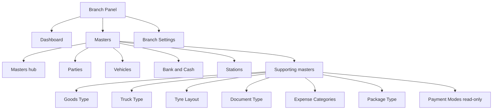
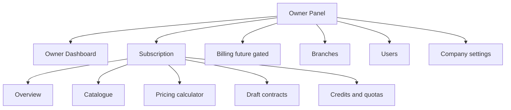

# B — Phase 3 IA and Navigation

**Status:** Proposed for Product Owner design review  
**Shell:** Reuse Phase 2 `AppSidebar`, Owner vs Branch context, `CompanySwitcher`, breadcrumbs.

## 1. Branch Panel — Masters navigation

### Phase 3 Branch nav rules

| Rule                  | Behaviour                                                                                     | Label                                           |
| --------------------- | --------------------------------------------------------------------------------------------- | ----------------------------------------------- |
| Hide undeveloped ops  | Enquiry / Broker / OwnFleet / Partload / Accounting / Assets remain hidden until their phases | **Approved requirement** (PO-P2-DESIGN-MODULES) |
| Masters group visible | When user has at least `platform.operations.view` on active branch                            | **Design interpretation**                       |
| Create buttons        | Shown only when Create/Edit permitted; server remains authoritative                           | **Approved requirement**                        |
| Documents             | Not a top-level nav item; opened from parent detail                                           | **Proposal**                                    |
| Stations              | Visible to all with View; create/edit/default-transporter limited to Owner                    | **Approved requirement** (Rules §5)             |

### Masters hub (BP-M-00)

Card grid: Parties, Vehicles, Bank & Cash, Stations, Supporting masters. Each card: title, one-line purpose, primary CTA (List / Manage). Empty permission → omit card.

## 2. Owner Panel — Subscription navigation

| Rule                              | Behaviour                                                                                          | Label                                  |
| --------------------------------- | -------------------------------------------------------------------------------------------------- | -------------------------------------- |
| Extend existing Subscription page | Overview remains entry; add secondary tabs/links                                                   | **Design interpretation**              |
| Billing nav                       | Visible as “Billing” with badge “Requires payment setup” until PO-P3-PAY; or hide until authorized | **Proposal** — prefer hide until G-PAY |
| AUD-CON-006                       | Do not show invented restricted/suspended action matrices                                          | **Approved requirement**               |
| Deactivated company               | Owner may view subscription/billing info; no Branch ops                                            | **Approved requirement** (DEC-002)     |

## 3. Shared chrome

| Element        | Reuse                            |
| -------------- | -------------------------------- |
| Sidebar        | `AppSidebar` + `NavMain`         |
| Header         | `AppSidebarHeader` / breadcrumbs |
| Company switch | `CompanySwitcher`                |
| Status         | `WorkspaceStatusBadge`           |
| Empty          | `ShellEmptyState`                |
| Toasts         | `sonner`                         |
| Dialogs        | `ui/dialog`                      |

## 4. Document entry points

| Parent           | Entry                                     |
| ---------------- | ----------------------------------------- |
| Party detail     | Attachments section                       |
| Vehicle detail   | Attachments section                       |
| Bank/Cash detail | Attachments section                       |
| Station detail   | Attachments section (Owner-shared parent) |

Cross-parent file picker is **Out of scope** (no global file browser).

## 5. Breadcrumb patterns

- Branch: `Branch › Masters › Parties › {Name}`
- Owner: `Owner › Subscription › Pricing`
- Documents: stay on parent breadcrumbs; drawer title = document label
